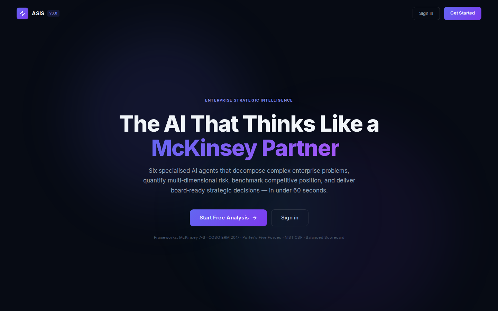
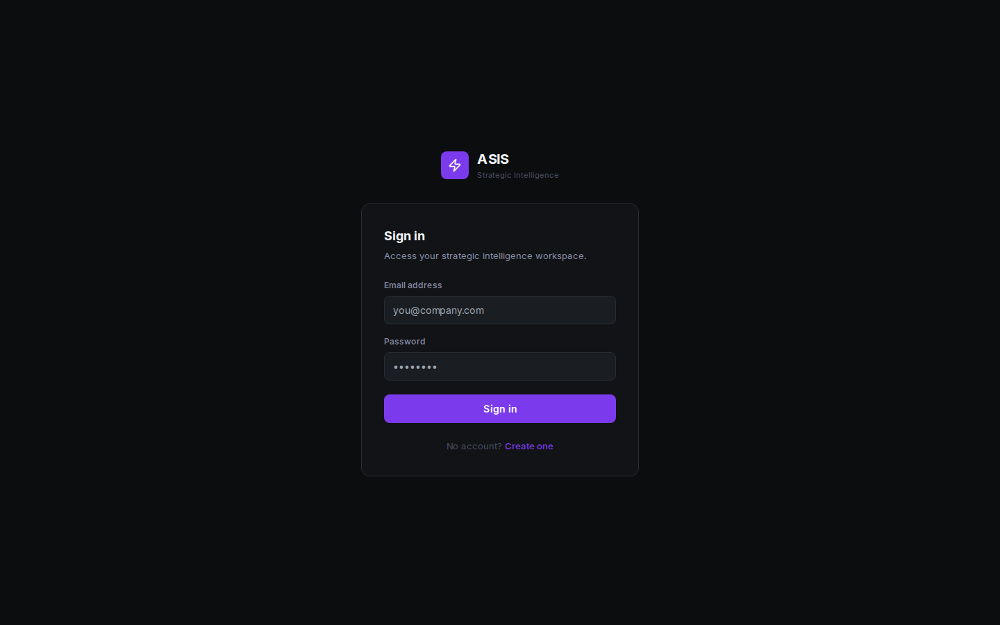
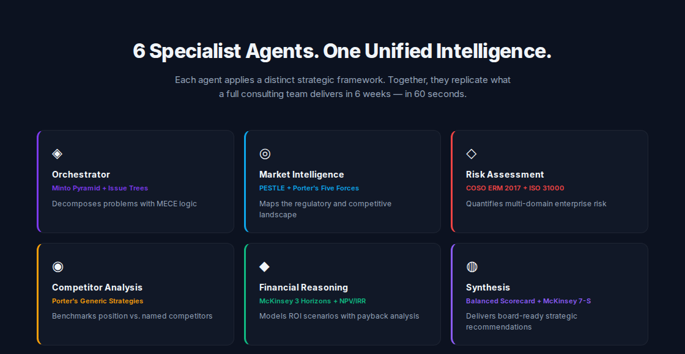
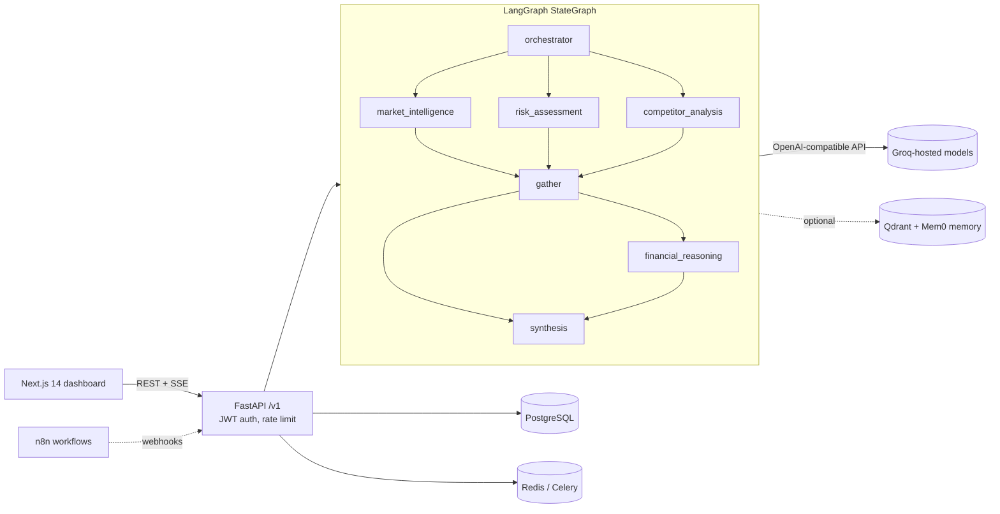

# Strategic Decision Maker — ASIS early prototype (v1–v4)

**An earlier, archived iteration of ASIS: a six-agent LangGraph pipeline (FastAPI + Next.js) that turns a strategy question into a structured decision brief.**

> [!IMPORTANT]
> **This is not the maintained version.** This repository holds the first ASIS prototype, built between 3 and 10 April 2026. Development moved to **[Akshatb848/Strategic-Consultant](https://github.com/Akshatb848/Strategic-Consultant)** on 11 April 2026, which is the current, maintained ASIS: an 8-agent pipeline, a newer dashboard, demo mode and an expanded test suite. Start there. This repository is kept for its history.

[](https://github.com/Akshatb848/Strategic-Decision-Maker/actions/workflows/ci.yml)
[](LICENSE)


## How it relates to the other ASIS repositories

| Repository | What it is | Status |
|---|---|---|
| [Strategic-Consultant](https://github.com/Akshatb848/Strategic-Consultant) | **Main ASIS codebase**: 8 agents, Next.js 15 dashboard, demo mode, CI | **Maintained — use this** |
| **Strategic-Decision-Maker** (this repo) | First code iteration of ASIS (v1.0 → "v4" in commit messages), 6 LangGraph nodes | Earlier prototype, not maintained |
| [ASIS-Base44](https://github.com/Akshatb848/ASIS-Base44) | Separate front-end-only ASIS prototype ("v5", Vite + React, April 2026) | Prototype, not maintained |

## Glimpse

Captured by running this repository's Next.js frontend locally (`next dev`) and screenshotting it headlessly with Playwright. No backend or LLM key was running, so these are the public pages only: no analysis was executed. Claims in the page copy, such as "under 60 seconds", are the app's own marketing text, not measured results.

| Landing page | Sign-in |
|---|---|
|  |  |



## What it does

A signed-in user submits a strategic question, for example a market-entry decision, plus company context. The backend runs a LangGraph `StateGraph`:

1. **Orchestrator** breaks the question down and decides which specialist agents to run.
2. **Market Intelligence**, **Risk Assessment** and **Competitor Analysis** run in parallel and fan in at a `gather` node.
3. **Financial Reasoning** runs when the query type needs it.
4. **Synthesis** produces a structured strategic brief: Pydantic-validated JSON rendered by the dashboard (risk matrix, competitor radar, export).

Progress streams to the browser over Server-Sent Events. Results are stored in PostgreSQL.

## Architecture



In the final commits the agents call an OpenAI-compatible endpoint, Groq by default, with per-agent model names set in [`asis/backend/config/settings.py`](asis/backend/config/settings.py). Earlier commits used Anthropic via a LiteLLM proxy. The commit history records each switch.

## Features (as implemented in this prototype)

- Multi-agent LangGraph pipeline with parallel fan-out/fan-in ([`asis/backend/graph/asis_graph.py`](asis/backend/graph/asis_graph.py))
- Pydantic schemas for every agent output and the final brief ([`asis/backend/agents/schemas.py`](asis/backend/agents/schemas.py))
- FastAPI backend: JWT register/login, analyses, reports, SSE streaming, health, evaluation endpoints
- PostgreSQL models with Alembic migrations and PostgreSQL row-level security policies
- Next.js 14 dashboard: agent status panel, strategy brief, risk matrix, competitor radar, PDF export
- Data connectors (web search, news, financial data) under [`asis/backend/mcp/`](asis/backend/mcp/)
- Docker Compose stack (Postgres, Redis, Qdrant, Langfuse v2, n8n, backend, Celery, frontend), plus Terraform/Cloud Build files for GCP
- 7 n8n workflow definitions under [`asis/n8n/workflows/`](asis/n8n/workflows/)

## Tech stack

Python 3.11 · FastAPI · LangGraph · Pydantic v2 · SQLAlchemy (async) · PostgreSQL · Alembic · Celery + Redis · Qdrant · Mem0 · Next.js 14 · TypeScript · Tailwind CSS · Recharts · Framer Motion · Docker Compose · n8n · Terraform (GCP)

## Quick start

```bash
cp .env.example .env          # set LLM_API_KEY and JWT_SECRET at minimum
docker compose up --build     # Postgres, Redis, Qdrant, backend, frontend, ...
# frontend: http://localhost:3000   backend: http://localhost:8000/v1/health
```

> `docker-compose.yml` sets `NEXT_PUBLIC_API_URL` to the IP of the original cloud VM. For a local run, override it to `http://localhost:8000/v1`.

Frontend only (no backend), as used for the screenshots:

```bash
cd asis/frontend && npm ci && npx next dev
```

## Environment variables

All variables are listed in [`.env.example`](.env.example). The main ones are:

| Variable | Required | Purpose |
|---|---|---|
| `LLM_API_KEY` | yes (to run analyses) | Key for the OpenAI-compatible LLM endpoint (Groq by default) |
| `LLM_BASE_URL` | no | Override the LLM endpoint |
| `JWT_SECRET` | yes | ≥ 32 characters, signs auth tokens |
| `DATABASE_URL` | yes | `postgresql+asyncpg://...` |
| `REDIS_URL`, `CELERY_*` | for background tasks | Redis broker / result backend |
| `TAVILY_API_KEY`, `FMP_API_KEY`, `NEWSAPI_KEY` | optional | External data connectors |
| `LANGFUSE_*`, `QDRANT_*` | optional | Tracing and vector memory |

## Testing

```bash
pip install -r asis/backend/requirements.txt aiosqlite
# Schema tests run anywhere; route tests need PostgreSQL:
export TEST_DATABASE_URL=postgresql+asyncpg://postgres@localhost:5432/asis_test
export JWT_SECRET=local-test-secret-at-least-32-characters ENVIRONMENT=development
pytest -c asis/backend/tests/pytest.ini asis/backend/tests
```

The suite has 28 tests: agent and brief schema validation, plus auth and reports API routes run against a real PostgreSQL. Route tests are skipped when `TEST_DATABASE_URL` is unset. CI ([`.github/workflows/ci.yml`](.github/workflows/ci.yml)) runs them against a PostgreSQL service container, along with a Ruff check for syntax errors and undefined names and a TypeScript type-check of the frontend. Line coverage of `asis/backend` is about 51%. The agents and graph are not exercised without an LLM key.

## Project structure

```
asis/
  backend/   FastAPI app, LangGraph graph, agents, schemas, DB models + migrations, Celery tasks, tests
  frontend/  Next.js 14 dashboard
  n8n/       n8n image + workflow JSON
  infra/     Terraform + Cloud Build for GCP
docs/        screenshots, original v3.0 README (docs/original-readme-v3.md)
docker-compose*.yml, railway.toml, vercel.json   deployment configs from the prototype phase
```

## Limitations

- **Superseded.** Fixes and features land in [Strategic-Consultant](https://github.com/Akshatb848/Strategic-Consultant), not here.
- No hosted demo. The GCP VM deployment referenced in `docker-compose.yml` and `build-images.yml` is not maintained.
- An analysis needs a working LLM key. There is no offline or demo mode in this version (Strategic-Consultant adds one).
- The Next.js build ignores TypeScript and ESLint errors (`next.config.js`). CI runs `tsc --noEmit` separately, and it passes.
- `next@14.2.18` has a published security advisory. Upgrade before any real deployment.
- No evaluation results are published for this prototype.

## License

[MIT](LICENSE) © 2026 Akshat Banga

## Author

**Akshat Banga** — [github.com/Akshatb848](https://github.com/Akshatb848)
